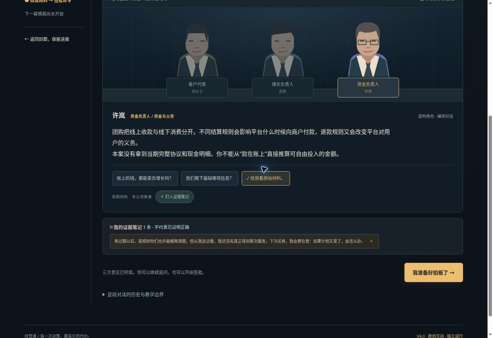

# 经营者 · Business Command

**一场由你拍板的商业悬局。**

进入真实公司的历史关口，与不同诉求的NPC交谈，收集证据，在答案揭晓之前作决定，再逐幕对照历史。

[开始体验](https://tonylin231011.github.io/business-command/) · [原课程与案例库](https://tonylin231011.github.io/business-command/library.html) · [贡献指南](CONTRIBUTING.md) · [内容说明](NOTICE.md)




## 已经可以玩什么

首集 **STR-0001《千团大战：下一笔钱》** 已具备三幕完整流程，约20分钟。

- 三幕：退款承诺、融资后获客投入、区域组织承载。
- 每幕三位角色；每位三条追问入口（含原始材料），共27条入口。
- 点击NPC切换立场，追问，标记已经实际听到的回答到证据笔记。
- 听取三方意见后选择路线，留下理由、改变条件和把握。
- 提交后打开本幕历史动作、依据、路线假设与替代方案；主动继续才推进。
- 幕间来信、持久化进度、JSON备份恢复、独立HTML复盘、完整离线单页。

NPC是预先编排的虚构教学角色；无需AI接口，不提供自由聊天。即时检验按所选路线生成，文字质量待教练复核；不按“与历史一致”判满分，不生成虚构市占率或利润。

原课程库的30条案例、7组入门训练是不同成熟度的资料条目，**不代表30集互动剧已经完成**。

## 本地运行与构建

无需Node依赖、账号或API密钥。直接打开 `index.html`；或在仓库目录执行：

```sh
python3 -m http.server 8000
```

浏览器访问 `http://localhost:8000/`。网页“使用说明”也可下载离线完整单页。外部史料查看需要联网。

修改源文件后构建：

```sh
python3 build.py
node tests/smoke.cjs
```

`build.py` 将 `src/base.html` 的运行核心、`src/episode-base.json` 的案例、`game.js` 的NPC交互、`style.css` 的样式与编排数据组合成独立 `index.html` 和 `episode-STR-0001.json`。首次运行无需构建。

## 文件结构

| 文件 | 用途 |
|---|---|
| `index.html` | 可部署、可离线运行的完整产品 |
| `game.js` / `style.css` | V4互动层与视觉 |
| `build.py` / `src/` | 可复现构建与基础剧本 |
| `episode-STR-0001.json` | 包含NPC和出处的结构化案例 |
| `tests/smoke.cjs` | 内置Node状态检查，无需安装依赖 |
| `experience-v3.html` / `archive-v2.html` | 旧版保留入口 |
| `docs/` | 48小时范围、案例规范与路线图 |
| `promo/` | 宣传草稿，尚未对外发布 |

## 学习记录属于你

数据只写当前浏览器localStorage。保留 `business-command-v3` 键以兼容旧答卷，新交互在原记录上追加对话和笔记；V2键不改动。课程库使用独立备份。更换设备、离线文件位置或清理浏览器前，请导出JSON。不提供自动云同步。

项目没有配置分析埋点、广告或远程AI调用；外部史料和GitHub链接由你点击打开。网页托管服务自身的访问日志不在本应用控制范围内。不要在公开issue附带你的私人答卷或业务数据。

## 证据规则

历史事实、当事人主张、回顾性解释、教学演绎与未知分别标注。历史后续按幕开放；静态代码可被主动查看，不是防作弊系统。未披露的预算与现金跑道不虚构，不把后来的成功当作当年决策必然正确的证据。

## 贡献与许可

欢迎改进移动端体验、补充史料和提出新案例。先阅读 [CONTRIBUTING.md](CONTRIBUTING.md) 与 [案例规范](docs/CASE_AUTHORING.md)。原创代码和教学编排采用MIT许可证，第三方资料权利见 [NOTICE.md](NOTICE.md)。

这是公开体验版，仍在迭代。目前仅首集完整；尚无NPC自由对话、跨设备云同步、自适应课表或自动文字评分。
